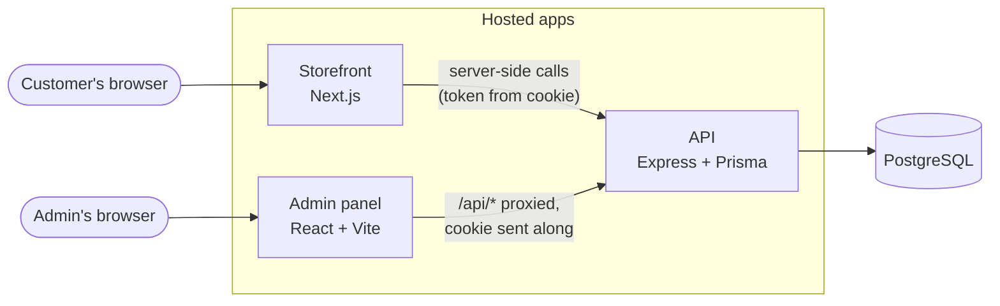
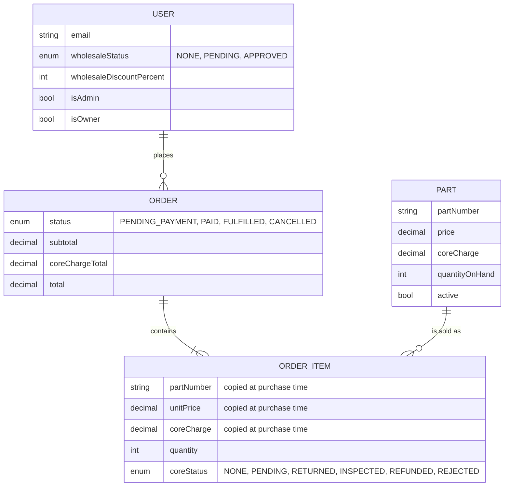
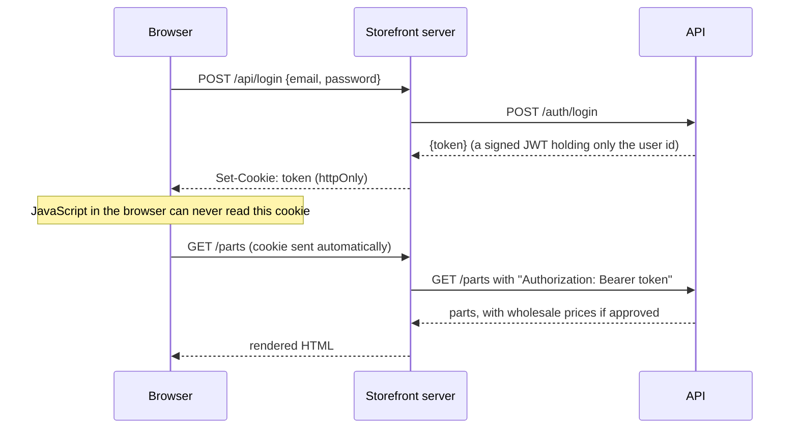
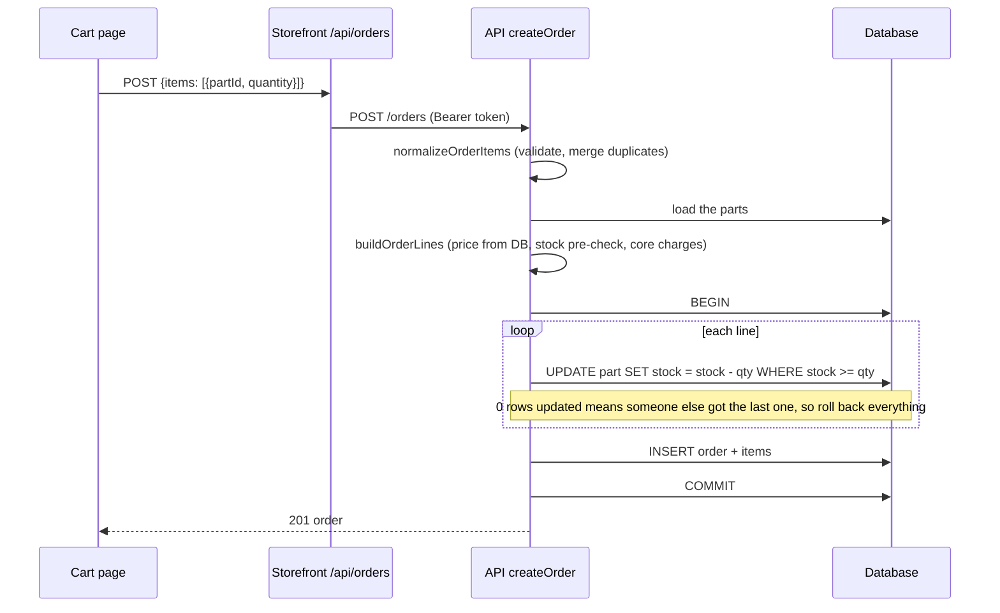

# Architecture walkthrough

This explains how the project fits together, in the order that makes it easiest to understand. If you are rebuilding it to learn it, read [How to rebuild it](#how-to-rebuild-it-a-suggested-order) first and use the rest as a reference.

## The big picture

Three apps and one database. Only the API talks to the database.



The key idea: **the API is the only place that makes decisions** about prices, stock and permissions. The two frontends are displays that ask the API and show the answer. Anything a frontend computes (a cart total, a "20% off" label) is for convenience; the API recomputes it before it matters.

## Where to look: the repo map

```
api/
  prisma/schema.prisma       the data model (start here)
  prisma/seed.js             demo data: fake catalog, demo users, sample orders
  src/index.js               builds the Express app, mounts the routers
  src/routes/                which URL goes to which controller, and who may call it
  src/controllers/           the request handlers: read input, call services, send a response
  src/services/              the business rules, as plain functions (no database, no Express)
    pricing.js                 wholesale maths, cart validation, building order lines
    orderStatus.js             the order state machine
    partValidation.js          input checks for creating and editing parts
    wholesale.js               "what may this person see?" (the one service that reads the database)
  src/middleware/auth.js     login-token checks, admin check
  test/                      unit tests (pure services) and checkout-flow tests

storefront/
  lib/api.js                 server-side helpers that call the API
  lib/site.js                the fictional business's details and the demo accounts
  lib/format.js              money formatting and the stock labels
  app/api/*/route.js         the backend-for-frontend routes (login, register, orders, cart refresh, ...)
  app/context/CartContext.js the cart (localStorage) and the refresh-from-server logic
  app/parts, cart, orders    the shop pages
  app/components             header, footer, home page sections

admin/
  src/api/                   thin wrappers around fetch() for the API
  src/pages/                 Parts, Users, Orders, Login
  src/components/ProtectedRoute.jsx   only admins get past this
```

**Suggested reading order:** `schema.prisma` → `services/pricing.js` → `controllers/ordersController.js` → `routes/*.js` → `middleware/auth.js` → `storefront/app/api/login/route.js` → `storefront/app/context/CartContext.js` → `storefront/app/cart/page.js` → `admin/src/pages/Orders.jsx`. That follows one order from the data model, through the rules, to both screens.

## The data model



Why `ORDER_ITEM` copies the part number, description and price: an order is a historical record. If the part's price changes next year, last year's order must still show what was actually charged.

## The request flows

### Logging in (the backend-for-frontend pattern)



The storefront's own server sits between the browser and the API. Because the browser only ever talks to the storefront, the token can live in an `httpOnly` cookie, which makes it unreachable to any script injected into the page.

The admin panel is a plain single-page app with no server of its own, so it calls the API directly and the API sets the cookie. To keep that cookie first-party, the admin calls `/api/...` on its own domain and the dev server / Netlify forwards it to the API.

### Browsing as a wholesale customer

`GET /parts` runs `optionalAuthenticate`: with a token the caller is identified, without one they are anonymous. `getWholesaleInfo` then **looks the user up in the database** and answers "may this person see wholesale prices, and what is their discount?". Only if yes does `attachWholesalePrice` add a `wholesalePrice` field. Anonymous visitors and unapproved users get parts with no such field at all, so there is nothing to find in the network tab.

### The cart

The cart lives in the browser's localStorage: part ids, quantities and a snapshot of each part for display. Snapshots go stale, so when the cart page opens it calls `/api/cart/refresh` (a storefront route) which calls `POST /parts/lookup` on the API as the current user. That returns current prices (wholesale ones if you are now logged in), core charges and stock. Parts that are gone or sold out are flagged and block checkout.

### Checking out (the most important flow)



Things to notice:

- The client sends only **ids and quantities**. Prices are looked up by the server.
- The stock check has two layers. `buildOrderLines` gives a friendly error early. The conditional `UPDATE` inside the transaction is the real guard: it is a single atomic statement, so two simultaneous buyers cannot both take the last unit.
- All lines succeed or none do.

### Admin changes an order

`PUT /orders/:id/status` loads the order, asks `orderStatus.canTransition` whether the move is legal, flips the status with a guard that fails if someone else changed it first, and, for a cancellation, puts the stock back. The admin UI never hard-codes the rules: each order the API returns includes `allowedStatuses`, and the UI draws one button per allowed move.

## Where each rule is enforced

| Rule | Enforced in |
| --- | --- |
| Only approved wholesale users see wholesale prices | `services/wholesale.js` + `attachWholesalePrice` in `partsController.js` |
| Prices come from the database, not the client | `services/pricing.js` `buildOrderLines` |
| Stock can never go negative or be sold twice | conditional `UPDATE` in `ordersController.createOrder` |
| Inactive parts are hidden from the public | `getAllParts`, `getPartById`, `lookupParts` |
| Only admins can change parts, users and orders | `requireAdmin` in `middleware/auth.js` (reads the database) |
| Orders can only make legal status moves | `services/orderStatus.js` |
| Cancelling an order restocks the parts | `ordersController.updateOrderStatus` |
| The owner and the last admin cannot be demoted | `usersController.removeAdmin` |
| A part with order history cannot be deleted | `partsController.deletePart` (database foreign key, mapped to a 409) |
| The supplier feed needs a secret token | `partsController.getSupplierFeed` |

## Vocabulary

- **Core charge:** a refundable deposit on a rebuildable part (injectors, pumps, turbochargers). You get it back when you return your old part, because the shop can rebuild it.
- **Wholesale:** discounted pricing for approved business customers.
- **BFF (backend-for-frontend):** a small server that exists only to serve one frontend. Here, the Next.js route handlers.
- **JWT:** a signed token proving who you are. Here it holds only the user id.
- **Transaction:** a group of database changes that either all happen or none do.

## How to rebuild it: a suggested order

Build it in thin vertical slices, running each one before moving on. Copying functions from this repo is fine; the goal is to understand how a request travels, so run it and click through after each step.

1. **API skeleton + data model.** Express app, Prisma schema, one migration, `GET /parts`. Hit it in the browser.
2. **Seed data.** Copy `prisma/seed.js` so you have something to look at.
3. **Storefront catalog.** A Next.js page that fetches `/parts` on the server and renders a grid.
4. **Auth.** `register` and `login` in the API, then the storefront's `/api/login` route handler and cookie. Watch the cookie appear in dev tools.
5. **Wholesale pricing.** `optionalAuthenticate`, `getWholesaleInfo`, `attachWholesalePrice`. Log in as the wholesale user and compare responses with and without the cookie.
6. **Cart.** `CartContext` and the cart page, with no checkout yet.
7. **Checkout.** `normalizeOrderItems`, `buildOrderLines`, then `createOrder` with the transaction. Try to oversell a part on purpose.
8. **Admin.** Vite app, `ProtectedRoute`, Parts page, then Orders with status buttons.
9. **Polish.** Cart refresh, stock labels, the order state machine, tests.

After each step, check one thing in the network tab: what did the browser actually send, and what came back?
